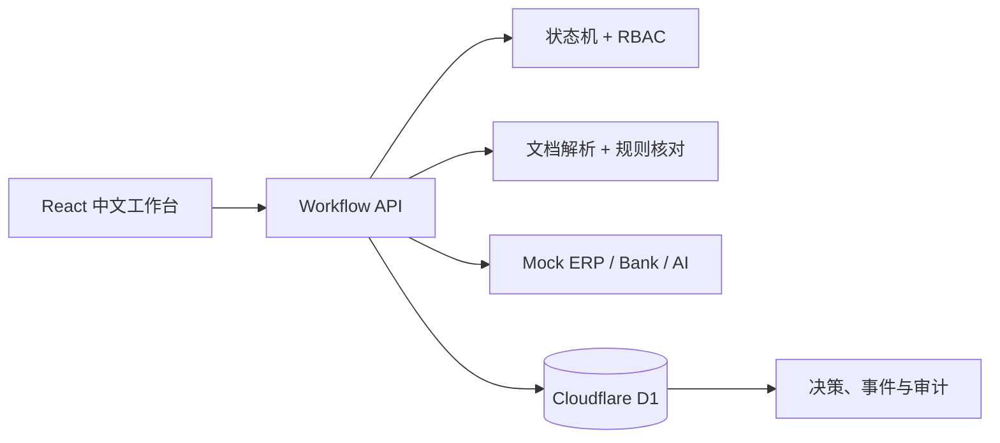

# CrossBorder Flow AI

> 面向新加坡与东南亚企业跨境付款的任务驱动操作工作台：让文件核对、人工审批、银行状态追踪与异常处理共享同一笔可解释、可审计的交易上下文。

[**打开 Live Demo →**](https://crossborder-flow-ai.gaoyiyuan482.chatgpt.site)

这是一个独立作品集技术 PoC，不是银行官方项目，不连接真实银行或 ERP，不处理真实客户资料，也不会让 AI 自动审批付款或修改收款账号。

## 为什么做这个项目

传统跨境付款操作需要人员在发票、ERP、审批和银行状态之间反复切换。本项目用固定合成付款 `PAY-2026-0482` 演示一条连续工作流：

1. Samuel（Maker）选择模拟发票 `INV-MY-2048.pdf`。
2. 后端解析发票并读取 Mock ERP 的 `SUP-MY-018`。
3. 确定性规则发现发票账号 `8821` 与 ERP 账号 `8812` 不一致。
4. Samuel 必须填写独立核实渠道、证据引用和确认账号。
5. Ajith（Approver）独立批准、退回或拒绝。
6. Mock Bank API 发送 Submitted、Processing、Delayed 或 Completed 事件。
7. `EVT-5821` 创建异常案例；模拟 AI 整理已有证据并提出建议。
8. 人工确认跟进后付款仍保持 Delayed，只有独立 `PAYMENT_COMPLETED` 事件可以完成付款。

## 核心功能

- 中文企业付款工作台与清晰的下一步行动
- 真实执行的发票/ERP 字段解析与确定性账户比较
- 必填证据的人工核实，不允许“一键绕过”
- Maker/Approver 权限与服务端职责分离
- 可拒绝、退回、失败和延迟的有限状态机
- 唯一 event ID、来源校验、重复幂等和乱序拒绝
- 基于当前交易上下文的可复现模拟 AI provider
- Cloudflare D1 持久化与追加式审计记录
- 按浏览器 session 隔离的公开演示数据
- 正常、账户不符、审批拒绝、银行延迟和银行完成场景控制台

## 架构



详细说明：

- [系统架构](docs/architecture.md)
- [状态转换矩阵](docs/state-transitions.md)
- [角色权限](docs/permissions.md)
- [威胁模型](docs/threat-model.md)
- [真实测试记录](docs/evaluation.md)

## 已实现与模拟边界

| 能力 | V1 状态 |
|---|---|
| 文档字段解析与账户比较 | 已实现的确定性程序规则 |
| 后端权限、状态转换与审计 | 已实现并自动化测试 |
| 持久化 | Cloudflare D1 |
| Maker / Approver | 模拟身份；权限由后端强制 |
| ERP / 银行 | 明确标注的合成 Mock API |
| AI | 可替换 provider 接口；V1 使用确定性模拟输出 |
| 真实付款、真实账户验证 | 未实现 |
| 银行或 ERP 生产连接 | 未实现 |
| 生产合规与安全认证 | 未实现 |

## 仓库结构

```text
crossborder-flow-ai/
├── app/                    # React 页面与 API routes
├── lib/                    # 状态机、规则、fixtures、AI provider
├── db/                     # Drizzle schema
├── drizzle/                # D1 migrations
├── fixtures/               # 合成发票、ERP、银行事件
├── tests/
│   ├── unit/
│   ├── integration/
│   └── e2e/
├── docs/
├── .github/workflows/ci.yml
└── README.md
```

## 本地运行

需要 Node.js 22。

```bash
npm ci
npm run db:generate
npm run build
node --import ./scripts/sites-env.mjs ./node_modules/wrangler/bin/wrangler.js d1 execute DB --local --config dist/server/wrangler.json --persist-to .wrangler/state --file drizzle/0000_flowery_eternity.sql
node --import ./scripts/sites-env.mjs ./node_modules/wrangler/bin/wrangler.js d1 execute DB --local --config dist/server/wrangler.json --persist-to .wrangler/state --file drizzle/0001_supreme_stingray.sql
npm run start
```

浏览器打开 Wrangler 输出的本地地址。演示页面会在当前浏览器生成独立 session，可在“演示控制台”中重置。

## 测试

```bash
npm run lint
npm run typecheck
npm test
npm run test:e2e
npm run build
```

2026-11-12 本地实际结果：

- Unit：12/12 通过
- Integration：6/6 通过
- Playwright E2E：1/1 综合流程通过
- ESLint、TypeScript、production build：通过

GitHub Actions 会在每次 push 和 pull request 上重新运行同一套检查。测试代码和详细执行证据见 [docs/evaluation.md](docs/evaluation.md)。

## 安全说明

- 只使用合成数据，不要上传真实发票、账号、凭证或客户信息。
- AI 不能审批、提交银行、修改收款账号或改变银行状态。
- 人工“已跟进”不等于银行“已完成”。
- 公开 Demo 是作品集研究原型，不适用于生产付款。

## 已知限制

- 文档解析使用可复现文本 fixture，不是生产 OCR。
- 角色切换不是企业 IAM。
- Mock Bank 不验证签名、mTLS 或真实 webhook。
- D1 适合本演示；生产系统仍需韧性、灾备、数据驻留、保留和合规设计。

## 来源与版权声明

本仓库是个人后续 AI/技术 PoC。原始 UX 挑战与本人的工程实现应被明确区分；仓库不包含未经授权的银行品牌资产，也不代表 Standard Chartered 或任何其他银行的官方产品。

License：仅供作品集展示与学习；如需复用，请先联系仓库作者。
