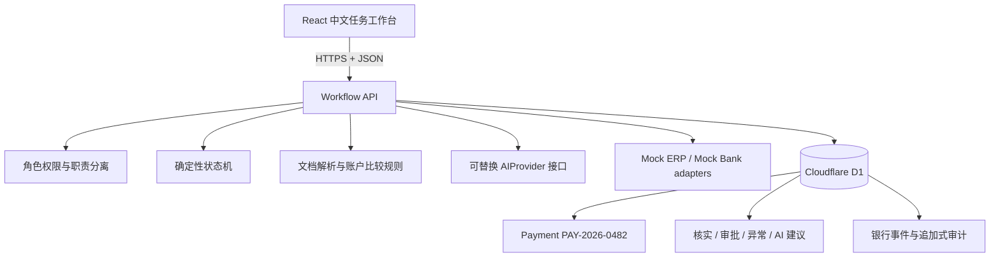

# 系统架构

## 可信边界

- 浏览器负责呈现、表单反馈和模拟角色切换，不是授权边界。
- `app/api/workflow/route.ts` 使用 Zod 验证请求，再调用 `lib/domain.ts` 的确定性规则。
- 后端状态机强制 Maker/Approver 分离、有效核实证据、银行事件顺序和合法完成条件。
- D1 保存状态快照、原始文件记录、比较结果、核实与审批决定、银行事件、异常、模拟 AI 建议和审计记录。
- 每个浏览器生成独立演示 session；D1 主键使用 `PAY-2026-0482::<session>`，UI 始终显示固定业务 Payment ID，访客之间互不覆盖。

## Adapter 边界

- Document adapter：从明确标注的文本 fixture 提取字段，不是生产 OCR。
- ERP adapter：返回 `SUP-MY-018` 的合成记录。
- Bank adapter：只接受受支持的模拟事件，校验来源、event ID、顺序并去重。
- AI provider：`DeterministicMockAIProvider` 根据当前状态产生可复现建议；`FailingAIProvider` 用于验证降级路径。

V1 不连接任何真实银行、ERP 或付费模型。
